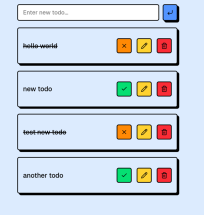

# Todo List CRUD with Next.js
## Prerequisites
- Bun or Node.js LTS

## Preview


## Project Setup

### Clone the Repository
```bash
git clone https://github.com/vennius/todo-list-next
cd todo-list-next
```

### Install Dependencies
```bash
bun install
```

### Copy .env File
```bash
cp .env.example .env
```

### Push database
```bash
bun run db:push
```

### Run the Development Server
```bash
bun dev
```
